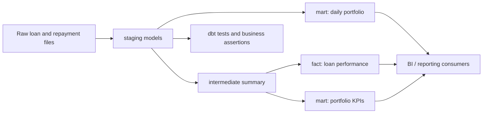

# Loan analytics architecture

This project follows a straightforward analytics engineering flow designed to keep logic clear, testable, and easy to reason about.

## Layer responsibilities

- Staging: standardise raw inputs, clean field names, carry forward only useful columns.
- Intermediate: build reusable loan-level logic such as outstanding balance and repayment summaries.
- Fact: expose one row per loan with current principal, repayment, and outstanding-balance metrics.
- Daily mart: calculate day-by-day portfolio movements using a calendar date spine and cumulative balance logic.
- KPI mart: summarise portfolio totals and active-loan behaviour from the intermediate summary.
- Tests: validate not-null, uniqueness, relationships, and business consistency rules.

## Why this structure matters

This architecture keeps the pipeline understandable and reduces the risk of business logic being duplicated across reports. It also makes it easier to demonstrate production-minded analytical quality to reviewers and stakeholders.
